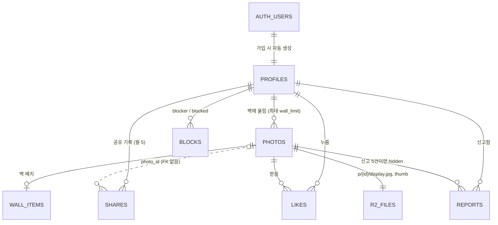

# 순간들 (Moments) 설계 — Photowall + 공유하기

메뉴 이름: **순간들**, 영어로는 **Moments** (2026-11-10 결정. 한때 "순간"이었다가 커밋된 코드는 "순간들"). 코드, DB, 서버에서는 계속 `moment`라는 이름을 씀. 이 문서의 "Moment"도 같은 기능을 가리킴.

상태: 구현 중 (2026-11-10).
- 앱 쪽 1단계(이미지 만들기, 촬영 정보, `MomentStore` + `MockMomentStore`)는 `Sources/Shared/Moment/`에 있음.
- 서버 코드: `supabase/migrations/`(DB 2개), `supabase/functions/`(Edge Function 5개), `workers/moment-img/`(Worker).
- **배포됨 (2026-11-10)**: Supabase 프로젝트 `rqnwgvfirkfxfawnawzf`(서울)에 DB 2개 적용(적용 기록 포함), Edge Function 5개 배포, pg_cron 정리 작업(매시 정각, 비밀값은 Vault `moment_cron_secret`). Worker는 `https://moment-img.moment-img.workers.dev`(R2 버킷 `moments`)에 있고, `app_config.image_base_url`에도 넣음.
- 비밀값 등록됨 (2026-11-10, `scripts/moment-secrets.sh`): R2 키 + `CRON_SECRET`(Edge Function), `moment_cron_secret`(Vault). 임시 함수로 R2 presigned PUT → HEAD → DELETE가 동작하는 것을 확인함(함수는 바로 삭제).
- 앱 연결 (2026-11-10): supabase-swift 2.55.6을 SPM으로 두 타겟에 추가. `SupabaseMomentStore`(DB·함수·R2 PUT), `MomentAccount`/`MomentAccountView`(Sign in with Apple → 핸들 → "벽 n/15 · 이번 달 공유 n/5", 로그아웃, 계정 삭제)를 `순간들` 탭에 붙임. 두 앱에 `com.apple.developer.applesignin` 추가. Supabase Apple 공급자는 `supabase/config.toml`의 `[auth.external.apple]`(client_id = 번들 id)를 `config push`로 켬.
- 고친 것: 비로그인 상태에서 사진을 읽으면 `blocks` 권한 오류 → `blocked_by_me()` 함수로 바꿈(`20261110010000_moment_blocks_check.sql`, 적용됨).
- Google 로그인 (2026-11-10): Google Cloud 프로젝트 `gr-everyday`의 웹 OAuth 클라이언트 → Supabase. 앱은 `WebSignIn`으로 시스템 로그인 시트를 직접 띄움(supabase-swift 내장 방식은 macOS 27에서 액터 검사로 앱이 멈춤). 버튼은 Apple 버튼과 크기·모양을 맞춘 `GoogleSignInButton`. Mac 앱에서 Google 로그인 성공 확인.
- 이름 규칙 (2026-11-11, `20261111010000_moment_names.sql`, 적용·시험함): **표시 이름**은 한글·이모지 가능 1–20자, 대소문자·한글 조합 방식 무시하고 중복 불가, 언제든 변경. **@사용자명**은 `set_handle()`로만 변경(앱이 직접 못 바꿈). 처음 정한 뒤로는 30일에 한 번, 이전 사용자명은 `handle_holds`에 14일 보호. 중복 확인은 `handle_available()` / `display_name_available()`(로그인한 사용자만).
- 사용자명 (2026-11-11): 2–20자(`20261111000000_moment_handle_min2.sql`, 적용됨). 입력하는 동안 형식과 중복을 바로 알려 줌. 로그인 후 언제든 "사용자명 변경". 로그아웃·탈퇴 버튼은 사용자명을 정하기 전 단계부터 보임.
- 시뮬레이터(iOS 26.3 런타임)는 Google 로그인 페이지에서 WebContent가 JavaScriptCore 충돌로 죽음 → 실제 기기나 Mac 앱으로 시험.
- 피드 (2026-11-11, `MomentFeedView.swift`): 순간들 탭 위쪽에 "피드 / 내 순간들" 전환. 피드는 공유된 사진 그리드(30장씩, 끝에 닿으면 다음 페이지), 타일에 표시 이름과 좋아요 수. 누르면 상세: 크게 보기, 표시 이름 + @사용자명(내 사진이면 "나"), 캡션, 촬영 정보, 좋아요(바로 반영, 실패하면 되돌림). 다른 사람 사진은 ⋯ 메뉴에서 신고(이유 5가지 = `reports.reason`)·차단. 신고하거나 차단하면 내 피드에서 바로 빠짐. 작성자 이름은 `author:profiles!photos_owner_fkey(handle,display_name)`로 함께 읽음(`likes` 때문에 `profiles`만 쓰면 관계가 두 개라 PGRST201). 내가 누른 좋아요는 `likes(among:)`로 읽음. Mac 앱에서 피드·상세·좋아요/취소(서버 like_count 1→0) 확인. 신고·차단은 다른 계정의 공유 사진이 있어야 시험 가능.
- 화면 다시 짬 (2026-11-12): 탭 안의 두 공간 이름은 **순간들 / 내 사진전**(영문 Moments / My Photowall, 사용자 확인 전 제안). 큰 제목이 곧 전환 버튼. 순간들은 사진을 원래 비율 그대로 한 줄(iPhone)·두세 줄(iPad·Mac)로 걸고(`MomentPhotoList`), 아래에 표시 이름·@사용자명·하트·캡션·촬영 정보 한 줄. 한 번 누르면 상세, 두 번 누르면 좋아요.
- 계정은 **설정 › 계정**(`MomentAccountSection`, 두 앱 공통)으로 옮김: 로그인 방법·메일 표시, 표시 이름·사용자명 변경, 좋아요한 사진, 신고 내역, 로그아웃, 탈퇴. `MomentAccount.shared` 하나를 탭과 설정이 같이 씀. 처음 로그인한 계정이면 어떤 계정인지(예: Google · 메일)와 "전에 쓰던 계정이면 로그아웃 후 같은 방법으로" 안내를 보여 줌.
- 신고 결과: `20261112000000_moment_report_status.sql`(2026-11-12 서버에 적용함, `schema_migrations`에 기록). `reports.status`(received/hidden/removed/dismissed), 사진이 지워져도 신고 기록은 남음. 앱은 열이 없으면 "접수됨"으로만 보여 줌. 운영자가 직접 검토할 때 쓰는 SQL은 파일 끝에 있음.
- 서버 프로필 2개(2026-11-12 확인): `soongone`(Google · hth33.dev@gmail.com, Mac에서 쓰는 계정)과 사용자명 없는 계정 하나. 휴대폰이 사용자명을 다시 물은 건 뒤쪽 계정으로 들어갔기 때문.
- 남은 것: Photowall 배치(그리드·자유), 차단 목록·차단 해제(설정), 썸네일 WebP, 약관 동의. 순간들 한 줄 보기에서는 600px 썸네일이 iPhone 화면(약 1200px)보다 작아 살짝 흐림 → 중간 크기는 지금은 두지 않기로 함(2026-11-13 사용자 결정).
- Supabase 연결(`SupabaseMomentStore`)과 화면은 아직 없음. `Sources/Shared/MomentView.swift`는 자리만 잡아 둔 화면.

## 0. 확정된 것
- 백엔드는 **Supabase**(로그인·DB·권한·Edge Function)와 **Cloudflare R2**(사진 파일). CloudKit은 쓰지 않음. Windows·Android도 같은 백엔드를 씀.
- 사진 읽기는 **도메인 없이** Cloudflare Worker의 무료 주소(`*.workers.dev`)로 함(5장). 나중에 도메인이 생기면 주소만 바꿈.
- 크게 보기는 **긴 변 3072px JPEG**(품질 약 90, sRGB). 썸네일은 **긴 변 약 600px WebP**(sRGB).
- **카메라 원본만** 올릴 수 있음. 앱에서 편집한 사진은 올리지 않음.
  - DNG는 DNG 안에 카메라가 넣어 둔 JPEG를 씀(2장).
- 업로드 파일에는 **EXIF를 넣지 않음**. 촬영 정보는 사용자가 공유를 고른 항목만 DB에 저장함(3장).
- **Photowall**(내 벽)과 **공유하기**(Share your moment, Moment 피드)를 나눔(4장).
  - 벽은 **최대 15장**. 나중에 결제로 늘림.
  - 공유하기는 **한 달 5장**.
- Photowall 배치는 **그리드와 자유 배치를 둘 다** 제공하고 사용자가 고름.
- 신고가 **5건** 쌓이면 자동으로 숨김.

## 1. 썸네일을 따로 두는 이유
썸네일은 "눌렀을 때 잠깐 보여주는 중간 이미지"가 주 용도가 아님. **그리드·Photowall에서 여러 장을 한꺼번에 보여주는 용도**가 핵심.

| 그리드 한 화면(약 30장)을 그릴 때 | 썸네일 있음 | 썸네일 없음(3072 JPEG만) |
|---|---|---|
| 내려받는 양 | 약 30 × 60KB ≈ **2MB** | 약 30 × 2MB ≈ **60MB** |
| 디코딩 메모리 | 작음 | 장당 약 36MB(3072×2048×4바이트). 스크롤 버벅임, iPhone 메모리 경고 |
| 저장 비용 | 사진당 +3% 정도 | 0 |

## 2. 이미지 만들기 (앱에서)

### GR DNG 안에 들어 있는 것 (2026-11-09, 사용자 GR IV HDF 파일로 확인)

| 들어 있는 것 | 내용 |
|---|---|
| RAW 센서 데이터 | 6304×4224, 약 30MB. Moment에서는 쓰지 않음 |
| **카메라가 만든 JPEG** | **6192×4128**. 이미지 컨트롤까지 적용됨. 같은 장면의 카메라 JPG와 픽셀 평균 차이 0.03~0.16/255 |
| 작은 미리보기 | 160×120 |
| EXIF | 모델, 셔터, 조리개, ISO, 촬영 일시, 35mm 환산 초점거리. JPG와 같은 값 |
| Ricoh MakerNote | 이미지 컨트롤 이름, 세부 설정 35개, HDF. `MakerNote.shot`이 DNG에서도 JPG와 똑같이 읽음 |

그래서 DNG 하나만 있어도 사진(카메라 JPEG)과 촬영 정보가 모두 있음. RAW를 현상할 필요가 없음.

### 원본만 받기
1. Ricoh MakerNote가 있고(`MakerNote.shot != nil`) 모델이 GR인 파일만 받음.
2. 앱의 편집값(`edits.json`)은 원본 파일과 따로 저장되므로, 업로드는 항상 편집 전 원본 파일을 읽음.
3. **DNG**: `CGImageSourceCreateThumbnailAtIndex`에 다음 옵션을 줘서 내장 카메라 JPEG만 꺼냄.
   - `kCGImageSourceCreateThumbnailFromImageIfAbsent: false`
   - `kCGImageSourceCreateThumbnailWithTransform: true`
   - 내장 JPEG가 없으면 업로드를 막음. 원본이 3072px보다 작으면 키우지 않고 그 크기 그대로 씀. 긴 변이 1080px 미만이면 막음.
4. JPG와 DNG가 둘 다 있으면 JPG를 씀. 결과는 같고 JPG가 더 빠름.
5. iPhone 사진 앱에 DNG만 있는 경우: `PHAssetResource`로 DNG 데이터를 받아 같은 과정을 거침.
6. **30MB짜리 DNG는 서버로 가지 않음.** 앱에서 만든 3072 JPEG와 썸네일(합쳐서 약 2~2.5MB)만 올라감.

### 렌더링
1. 긴 변 3072로 줄이고 방향을 반영한 다음 **sRGB로 렌더링**. 썸네일과 큰 사진의 색은 반드시 같아야 함.
   - JPG는 `DevelopEngine.load(url, maxEdge: 3072)`를 씀.
   - DNG는 위의 내장 JPEG를 씀.
2. 큰 사진: `CGImageDestination`으로 JPEG 품질 0.9. 메타데이터 딕셔너리는 넣지 않음(GPS·MakerNote 모두 빠짐).
3. 썸네일: 긴 변 600px, WebP 품질 약 80.
   - macOS 27의 ImageIO는 WebP를 **읽기만** 함(확인함). 그래서 libwebp를 SPM으로 추가함(예: `SDWebImage/libwebp-Xcode`). **패키지를 넣기 전까지는 썸네일을 JPEG(품질 0.8)로 만듦**(`ThumbEncoder`). 서버는 받은 형식 그대로 저장하므로 나중에 바꿔도 다른 수정이 필요 없음.
4. 걸리는 시간: 리사이즈와 인코딩을 합쳐 1초 미만으로 예상. 체감 시간은 업로드가 결정함.

## 3. 촬영 정보(EXIF) 공유 선택
파일에서는 EXIF를 모두 지우고, 공유할 항목만 DB 열에 저장함. 공유를 고르지 않은 정보는 서버에 아예 저장되지 않음.

| 묶음 | 내용 | 기본값 | DB 열 |
|---|---|---|---|
| 카메라 | 모델(GR IV, GR IV HDF …) | 켜짐 | `camera` |
| 노출 | 셔터, 조리개, ISO, 노출 보정, 35mm 환산 초점거리, 노출 모드 | 켜짐 | `exposure` (jsonb) |
| 이미지 컨트롤 | 이름, 세부 설정(`MakerNote.toneSettings`), HDF | 켜짐 | `image_control` (jsonb) |
| 촬영 일시 | 날짜·시각 | 켜짐 | `taken_at` |
| 위치 | 끄기 / 대략(소수점 2자리, 약 1km) | **꺼짐** | `lat`, `lon` |

- 설정 → Moment에서 **기본 공유 항목**을 정하고, 업로드 화면에서 사진마다 토글로 바꿀 수 있음.
- 올린 뒤에도 켜고 끌 수 있음. 끄기는 언제나 가능. 켜기는 그 사진의 원본이 기기에 있을 때만 가능.

## 4. Photowall과 공유하기 (Share your moment)

| | Photowall (내 벽) | 공유하기 (Moment 피드) |
|---|---|---|
| 무엇 | 내가 올린 사진을 원하는 대로 거는 개인 공간 | 벽의 사진 중 골라 모두가 보는 피드에 올림 |
| 제한 | **최대 15장**(무료). 결제하면 늘어남 | **한 달 5장** |
| 누가 봄 | 내 프로필에 들어온 사람 누구나 | 피드를 보는 사람 누구나 |
| 동작 | 업로드하면 바로 벽에 걸림. 지우면 자리가 비어 다시 올릴 수 있음 | 벽의 사진에서 "공유하기" → 피드에 올라감. 파일을 다시 올리지 않음 |

### 공유하기
- **한 달 기준**: 달력 월, UTC 기준(한국 시각 매월 1일 09:00에 초기화). 화면에 "이번 달 공유 3/5"처럼 보여줌.
- **공유 취소**는 가능함. 피드에서 내려가고 벽에는 남음. 쓴 횟수는 돌려주지 않음(올렸다 내렸다 하며 상위에 노출되는 걸 막기 위해).
- 공유한 사진을 벽에서 지우면 피드에서도 사라짐.
- 신고로 숨겨진 사진은 벽과 피드 모두에서 빠짐(본인에게는 보임).

### 벽 장수 제한과 결제
- 벽에 걸 수 있는 장수는 `profiles.wall_limit`에 사용자별로 저장함(기본 15). 업로드할 때 `moment-upload`가 "지금 장수 < wall_limit"인지 확인함.
- **하루 업로드 제한**: 지금은 **없음**. 변수 `app_config.limits.uploads_per_day`만 만들어 둠(`null` = 제한 없음). 숫자를 넣으면 `moment-upload`가 바로 적용하므로 앱 업데이트가 필요 없음.
- **결제는 나중에 추가함.**
  - App Store 규정상 앱 안에서 기능을 여는 결제는 **인앱 결제(IAP)** 를 써야 함(가이드라인 3.1.1). 소규모 사업자 프로그램이면 수수료 15%.
  - 구매가 확인되면 서버 함수가 `wall_limit`을 올림. App Store Server Notifications로 받고, Android가 생기면 Google Play 결제도 같은 방식으로 받음.
  - 여러 스토어를 한 번에 처리하려면 RevenueCat 같은 서비스도 고려할 수 있음. 일정 매출까지는 무료.
  - 상품 형태(일회성 구매 vs 구독)와 늘어나는 장수는 나중에 정함.

### 내 사진전 보기 방식 (2026-11-12 사용자 결정)
- **두 가지 보기**를 위쪽 전환 버튼으로 바꿈. 마지막에 고른 보기는 `profiles.wall_style`에 저장하고, 다른 사람이 내 사진전을 열 때도 그 보기로 보임.
  - **갤러리**: 벽 보기 + 편집 모드(아이디어 1+2). 액자(흰 여백·얇은 테두리) 안의 사진을 벽에 자유롭게 걸고, 사진 아래에 캡션. 편집 모드에서 길게 눌러 끌어 옮기기, 두 손가락으로 크기 조절. 값은 `wall_items`의 x, y, width, z(겹침 순서)에 저장.
  - **그리드**: 인스타그램 프로필처럼 위에 프로필(표시 이름·@사용자명·벽 n/15·공유 수), 아래 3열 정사각형 그리드. 순서는 `wall_items.grid_order`(최신이 앞). 길게 눌러 순서 바꾸기는 나중.
- 벽 방향: 편집에서 **세로로 길게 / 가로로 길게**를 고름(사용자 요청). 좌표는 벽의 짧은 변 기준 단위: x = 가로지르는 방향, y = 벽을 따라가는 방향, width = 액자 너비. 같은 값이 두 방향 모두에 그려짐. 방향을 바꾸면 그 방향에 맞게 자동 배치를 다시 깜. 방향은 `profiles.wall_direction`(마이그레이션 `20261112010000_moment_wall_direction.sql`, 2026-11-12 서버에 적용함, 앱에서 바꿀 수 있는 열로 권한 줌).
- 기울이기는 넣지 않음(`rotation` 0). 겹치기는 가능(누른 액자가 맨 앞으로).
- 전체화면 (2026-11-12): 갤러리일 때 편집 옆 ↖↘ 버튼. 어두운 방에 벽만 보이고, 화면을 누르면 닫기 버튼과 이름이 숨었다 나타남. 액자를 누르면 사진 상세. iPhone은 평소 세로 고정이지만 전체화면에서는 돌리는 대로 따라감(`Orientation.setFree`), 닫으면 세로로 돌아옴. Mac은 큰 시트로 엶. 세로 벽을 가로 화면에서 볼 때는 액자 크기를 화면 높이에 맞춰 줄임.
- 자동 배치: 2열 지그재그(가로 벽은 2줄). 서버가 새 업로드에 주는 자리(3열, 0.3 간격, 너비 0.3)에 있는 사진은 "아직 안 건 사진"으로 보고 손으로 건 사진들 뒤에 자동으로 이어 붙임. 편집 › 자동 배치로 전체를 다시 깔 수 있음.
- 구현: `MomentWallView.swift`(MomentWallView, WallGeometry, MomentProfileGrid, MomentProfileHeader). Mac은 크기 막대, iPhone·iPad는 두 손가락으로도 크기 조절. 디버그 빌드는 `-momentMock` 인자로 샘플 계정·사진 7장을 띄워 서버 없이 화면을 볼 수 있음. Mac·iPhone 시뮬레이터에서 배치·끌기·방향 전환·그리드 확인함.

### 내 사진전 프로필 (2026-11-12)
- 인스타그램 프로필처럼: 프로필 사진, 표시 이름·@사용자명, 벽·공유 수, 소개(150자), 사용 중인 카메라 칩, 인스타그램·웹사이트 아이콘(누르면 바로 열림), [프로필 편집] [사진 걸기].
- 프로필 편집(`MomentProfileEditView.swift`, 내 사진전과 설정 › 계정 두 곳에서 엶): 사진 고르기·지우기, 소개, 카메라(프로필에 공개 켜고 GR 기종 고르거나 직접 입력, 끄면 저장 안 함, 처음엔 최근 사진의 카메라를 제안), 인스타그램(@이름·주소를 붙여 넣어도 이름만 남김), 웹사이트(https 자동).
- 프로필 사진은 고른 뒤 동그란 가이드 화면(`MomentAvatarCropper`)에서 끌어서 위치, 두 손가락·막대로 크기를 맞춤. 사용자명은 어디서도 "@" 없이 보여 줌(인스타그램과 헷갈리지 않게; DB·링크 어디에도 @는 쓰지 않으며 입력 때 붙인 @는 떼어 냄). 헤더 순서: 표시 이름 / 사용자명 / 인스타그램·웹사이트 아이콘. 사용 중인 카메라는 여러 대(최대 5) 체크 가능, 칩으로 줄바꿈해 표시(`profiles.cameras text[]`, 마이그레이션 `20261112030000_moment_profile_cameras.sql`이 `camera`를 옮기고 지움, 2026-11-12 서버에 적용함).
- 프로필 사진: 맞춘 정사각형을 512px sRGB JPEG, 메타데이터 없음. R2 `a/{user id}/{version}.jpg`, Edge Function `profile-avatar`(start → PUT → finish, remove)만 `profiles.avatar_version`을 바꿈. 새 사진마다 번호가 바뀌어 캐시가 꼬이지 않고, 이전 파일은 지움. 탈퇴 시 `account-delete`가 같이 지움. Worker가 `/a/...` 경로도 보여 줌.
- DB: `20261112020000_moment_profile_extras.sql`(avatar_version, instagram, website, camera).
- **배포함**(2026-11-12): 마이그레이션(기록 포함), `profile-avatar`(새로)·`account-delete` 함수, Worker(`/a/` 경로, 기존 사진 경로 그대로 동작 확인). 함수 배포는 `functions deploy ... --remote=<ref> --use-api --yes`(에이전트 실행이라 `--yes` 필요). 로그인한 계정으로 프로필 사진 올리기도 2026-11-13 사용자가 확인함.

### 이름 변경·다른 사람 갤러리·댓글·자르기 (2026-11-13)
- 이름: **내 사진전 → 내 갤러리**(영문 My Gallery), **사진 걸기 → 사진 업로드**. 보기 전환의 "갤러리"는 "내 갤러리"와 겹쳐 **액자**로 바꿈(그리드는 그대로).
- 순간들 카드 위쪽에 작성자 프로필 사진·표시 이름·사용자명. 누르면 그 사람의 갤러리(`MomentPersonGallery`, `MomentPersonView.swift`): 프로필(사진·이름·소개·카메라·링크·사진/공유 수) + 그 사람이 고른 보기(액자 벽 또는 그리드), 액자면 전체화면도 가능. 작성자 사진은 `author:profiles!photos_owner_fkey(handle,display_name,avatar_version)`로 같이 읽음.
- 사진 상세(다른 사람 갤러리·내 사진. **순간들에서는 댓글창을 숨김**, 2026-11-13 사용자 요청)에 **댓글**: 300자, 작성자 사진·이름(누르면 그 사람 갤러리), "작가" 표시, ⋯ 메뉴로 삭제(내 댓글 또는 내 사진의 댓글)·신고(이유 5가지)·차단. 좋아요는 기존 그대로.
- DB: `20261112040000_moment_comments.sql` — `comments`(photo_id, author, body 1–300, hidden, report_count), `photos.comment_count`(트리거), `comment_reports`(신고 5건이면 숨김). 읽기는 사진을 볼 수 있고 차단하지 않은 사람의 숨겨지지 않은 댓글만. **2026-11-13 서버에 적용함**(`db query --remote -f`, `schema_migrations`에 기록, PostgREST 스키마 다시 읽음).
- 업로드 전 **자르기·회전**(`MomentPhotoCropper`): 90° 회전, 비율(원본·자유·1:1·4:5·3:2·16:9, 가로/세로 전환; 자유는 모서리·변 손잡이를 끌어 아무 모양으로, 놓으면 틀이 가운데로 와서 화면을 채움), 끌기·두 손가락·막대로 확대. 원본을 긴 변 4608px로 한 번 읽어 두고(`MomentImage.load`), 회전 → 자르기 → 3072로 줄여 업로드(`render(_:edit:)`). 잘린 부분의 긴 변이 1080px 아래로 내려가지 않게 확대 한도를 둠. 색·보정은 카메라 원본 그대로라 "원본만" 원칙은 유지.
- 사진 상세 정리 (2026-11-13): 본문은 사진 → 캡션 → 위치 → 댓글만. 촬영 정보는 오른쪽 위 (i) 시트(`MomentInfoSheet`, 기본 정보 / 노출 모드·셔터·조리개·ISO·노출 보정·초점 거리 한 줄씩 / 이미지 컨트롤 전체 항목·HDF / 위치). 내 사진의 공유·피드에서 내리기·삭제는 ⋯ 메뉴로. 위치는 "대략적인 위치 있음" 대신 직접 고른 장소 이름, 없으면 반올림 좌표의 동네 이름(CLGeocoder), 누르면 Apple 지도(`maps.apple.com`)로 열림. 저장된 노출 값은 원본 EXIF(R0000565: 1/30·F2.8·ISO 320·P·28mm)와 같음을 확인 — 한 줄에 "노출"로 묶어 보여 준 게 오해의 원인.
- 같은 날 이어서: 위치는 **정확한 값 그대로** 공유(공유 여부는 사진마다 고르므로, 사용자 결정). 앱의 반올림을 없애고 `20261113000000_moment_exact_location.sql`로 `begin_upload`의 반올림도 뺌(서버에 적용·기록함). 그 전에 올린 사진은 반올림된 값 그대로. 위치는 본문에서 빼고 (i) 시트에만. 상세의 사진은 화면 높이 60% 띠의 가운데에 놓이고, 누르면 `MomentPhotoViewer`(전체화면, 두 손가락·두 번 탭 확대, 확대 중 끌기, 아래로 끌어 닫기, iPhone 회전 허용).

### 카메라 직접 선택 (2026-11-14)
- GR 촬영 정보(리코 메이커노트 + GR 모델명)가 없는 사진은 거절하지 않고 카메라 선택 화면으로: 필름 GR(GR1·GR1s·GR1v·GR21·GR10), GR DIGITAL I–IV만 고를 수 있음. GR II 이후는 원본에 늘 정보가 있으므로 목록에 없음(앱 `MomentShotInfo.declarableCameras` = 서버 `DECLARED_CAMERAS`, 둘 다 고칠 것).
- 직접 고른 사진은 파일 메타데이터를 읽지 않음(스캔본의 EXIF·GPS는 스캐너/폰 것). 카메라는 항상 공유. HEIC·PNG·TIFF도 받음.
- DB: `20261114000000_moment_camera_source.sql` — `photos.camera_source`(`exif`/`declared`, 카메라 없으면 null), 올린 뒤 카메라를 바꾸면 트리거가 `declared`로. 신고 사유 `not_gr`(사진만). (i) 시트에 "직접 선택 · EXIF 아님".
- **배포함**(2026-11-14): 마이그레이션은 서버에 이미 적용·기록돼 있었음, `moment-upload` 함수 배포.

### Photowall 배치 (둘 다 제공, 사용자가 고름)
- **그리드**: 순서와 칸 크기(1×1, 2×1, 1×2, 2×2)만 정함.
- **자유 배치**: x, y, 너비, 겹침 순서, 회전. 벽에 액자를 거는 느낌.
- 두 배치의 값을 모두 저장하므로 방식을 바꿔도 이전 배치가 지워지지 않음. 지금 쓰는 방식은 `profiles.wall_style`에 저장함.

## 5. 파일 저장과 읽기 (R2, 도메인 없이)
- 경로: `p/{photo_id}/display.jpg`, `p/{photo_id}/thumb`(형식은 업로드할 때 알려 준 Content-Type. WebP를 넣으면 `image/webp`). id는 uuid라 추측할 수 없음. 파일은 바뀌지 않음.
- **읽기: Cloudflare Worker의 무료 주소** `https://moment-img.<계정>.workers.dev/p/{id}/thumb.webp`
  - Worker가 R2에서 바로 읽어서 `Cache-Control: public, max-age=31536000, immutable`을 붙여 보냄.
  - 무료 한도: 하루 10만 요청, 분당 1,000요청. 넘으면 다음 날(UTC 자정)까지 오류(1027)가 남.
  - `workers.dev`에서는 Cache API가 동작하지 않음. 그래서 **앱 쪽 디스크 캐시**가 주 캐시임. Cloudflare의 새 Workers Cache는 `workers.dev`에서도 된다고 하므로 설정할 때 켬.
  - `r2.dev` 공개 주소는 개발용이라 속도 제한(429)이 있어서 쓰지 않음.
- **나중에 도메인이 생기면**: DB에는 경로만 저장하고, 앞부분 주소는 `app_config.image_base_url`에서 받음. 앱 업데이트 없이 전환됨.
- 쓰기: 앱에 R2 키를 넣지 않음. Edge Function이 10분짜리 업로드 주소(presigned PUT)를 발급함. 주소에 파일 형식과 크기를 묶어 서명함.

## 6. 데이터 구조 (Supabase Postgres)
SQL 초안: `supabase/migrations/20261109000000_moment.sql`

### 관계도 (ERD)
데이터는 모두 Postgres 관계형 테이블. 사진 파일만 R2에 있고, 경로는 `photos.id`로 만듦.




| 테이블 | 용도 |
|---|---|
| `app_config` | 이미지 주소 앞부분, 제한 수치(`wall_photos_free` 15, `uploads_per_day` null(제한 없음), `shares_per_month` 5, `reports_to_hide` 5) |
| `profiles` | 핸들, 표시 이름, 소개, 벽 배치 방식(`wall_style`), **벽 장수 한도(`wall_limit`)** |
| `photos` | 벽의 사진. 상태 `uploading → published`(신고 5건이면 `hidden`), 크기, 캡션, 공유된 촬영 정보, 좋아요·신고 수 |
| `photos.shared_at` | 피드에 공유한 시각(피드 정렬 기준), 아니면 null |
| `shares` | 공유 기록. 취소하거나 사진을 지워도 남아서 한 달 5장 계산에 쓰임 |
| `wall_items` | Photowall 배치. 자유 배치와 그리드 값을 모두 저장 |
| `likes` / `reports` / `blocks` | 좋아요 / 신고 / 차단 |

**권한 (RLS + 열 단위 GRANT)**
- 읽기는 로그인 없이도 가능(`published`만). 내 사진은 상태와 상관없이 볼 수 있음.
- 사진 생성·게시·삭제는 **Edge Function을 통해서만** 가능(R2 처리, 벽 한도, 하루 제한(설정했을 때)).
- 공유와 공유 취소는 DB 함수 `share_photo` / `unshare_photo`로 처리함. 남은 횟수는 `shares_left()`로 확인함.
- 앱이 직접 수정할 수 있는 열: 캡션, 촬영 정보 열, 프로필 글, `wall_style`. **`wall_limit`은 앱이 바꿀 수 없음.**

## 7. Edge Functions (Deno)

| 함수 | 하는 일 |
|---|---|
| `moment-upload` | 로그인 → 핸들 있는지 → **벽 장수 < `wall_limit`** → (`uploads_per_day`가 숫자면) 오늘 업로드 < 그 값 → 크기 제한(큰 사진 8MB, 썸네일 300KB) → `uploading` 행을 만들고 업로드 주소 2개를 돌려줌 |
| `moment-publish` | R2에 두 파일이 있는지, 크기가 신고한 값과 같은지 확인(HEAD) → `published` + 벽에 배치 행 추가 |
| `moment-delete` | 내 사진인지 확인 → R2 파일 2개 삭제 → 행 삭제(공유 기록은 남음) |
| `account-delete` | 내 사진 파일을 모두 삭제 → `auth.admin.deleteUser`. App Store 5.1.1(v)에 따라 필수 |
| (나중) `purchase-verify` | 스토어 결제 알림을 받아 `wall_limit`을 올림 |
| 정리 작업(pg_cron) | 하루 넘게 `uploading`으로 남은 행과 파일 정리. 업로드 중인 행도 벽 장수에 포함되므로 꼭 필요함 |
| Worker `moment-img` | R2 읽기 전용(5장) |

## 8. 로그인
- **Sign in with Apple**: 네이티브 `ASAuthorizationController` → `supabase.auth.signInWithIdToken(.apple)`.
- Android·Windows를 시작할 때 Google 로그인을 추가함.
- 둘러보기는 로그인 없이 가능. 올리기, 공유, 좋아요, 신고, 차단은 로그인이 필요함.

## 9. 앱 구조 (Swift)
- `MomentStore` 프로토콜: `feed(after:)`, `wall(of:)`, `upload(_:)`, `share`/`unshare`, `sharesLeft`, `delete`, `like`, `report`, `block`, `updateSharing`, `saveWall`.
- `SupabaseMomentStore`: supabase-swift SPM 사용. 테스트용 `MockMomentStore`도 만듦.
- `MomentUploader`:
  1. 원본인지 확인
  2. 원본 고르기(JPG 우선, 없으면 DNG 내장 JPEG)
  3. 2장의 이미지 만들기
  4. `moment-upload` 호출
  5. PUT 2번(iOS는 백그라운드 `URLSession`)
  6. `moment-publish` 호출
- `MomentShareOptions`: 3장의 기본 공유 항목. `UserDefaults`에 저장함.
- 화면:
  - 피드(공유된 사진 그리드) → 상세(크게 보기 + 촬영 정보 칩, `ShotChips` 재사용)
  - 업로드 시트(사진 선택, 캡션, 촬영 정보 토글, "바로 공유하기" 체크, "벽 12/15 · 이번 달 공유 3/5" 표시)
  - Photowall(그리드/자유 배치 전환, 편집 모드)
  - 설정 → Moment(기본 공유 항목, 차단 목록, 계정 삭제)

## 10. App Store 요구사항
- 사용자 생성 콘텐츠(1.2): 신고 기능, 차단 기능, 신고 5건이면 자동 숨김 + 운영자 검토. 가입할 때 이용약관(불쾌한 콘텐츠 무관용) 동의. 앱 안에 연락처 표시.
- 계정 삭제(5.1.1(v)).
- 벽 장수를 결제로 늘릴 때는 인앱 결제(3.1.1).

## 11. 무료 한도 감각
- R2: 사진 1장 약 2~2.5MB → 벽 15장이 꽉 찬 사용자 1명이 약 37MB → 무료 10GB에 약 270명.
  - 넘으면 GB당 월 약 $0.015. 1,000명이 꽉 채워도(약 37GB) 월 약 $0.4.
- Worker: 하루 10만 요청. 캐시 없이 썸네일 30장짜리 화면을 하루 약 3,000번 볼 수 있는 양. 앱 디스크 캐시가 있으면 같은 사진은 다시 요청하지 않음.
- Supabase: DB 500MB면 충분함. 무료 프로젝트는 1주일 동안 활동이 없으면 일시정지됨(개발 중 주의).

## 12. 진행 순서
1. Supabase 프로젝트, R2 버킷, Worker(`moment-img`), 함수 비밀값 설정. 로컬 개발은 `supabase start`(Docker 필요).
2. 마이그레이션 적용 + Edge Function 4개 + Worker.
3. Swift:
   - 로그인
   - `MomentStore`
   - `MomentUploader`. 이미지 만들기는 단위 테스트로 확인: sRGB, 메타데이터 없음, 크기, DNG 내장 JPEG 사용.
4. 화면: 업로드 시트, Photowall(그리드부터), 피드, 상세, 공유 토글.
5. Photowall 자유 배치, 공유하기.
6. 신고, 차단, 약관, 계정 삭제 → 심사 제출.
7. (나중) 인앱 결제로 벽 장수 늘리기.

## 13. 서버 배포 (계정을 만든 뒤 한 번)
명령은 저장소 루트에서 실행. CLI는 `npx`로 받아 쓰므로 따로 설치할 필요 없음.

1. **Supabase**: supabase.com에서 새 프로젝트를 만듦(리전 Northeast Asia (Seoul)). 프로젝트 ref를 메모해 둠.
2. DB 적용:
   - `npx supabase login`
   - `npx supabase link --project-ref <ref>`
   - `npx supabase db push` → `supabase/migrations/`의 두 파일이 적용됨.
3. **Sign in with Apple**: Supabase 대시보드 → Authentication → Providers → Apple을 켜고, 앱 번들 id(`com.hantaehee.greveryday`)를 넣음.
4. **Cloudflare R2**:
   - Cloudflare 가입 → R2 켜기(카드 등록 필요, 무료 한도 안에서는 0원).
   - 버킷 `moments`를 만듦.
   - R2 API 토큰을 만듦(Object Read & Write, `moments` 버킷만). Account ID, Access Key ID, Secret Access Key를 메모해 둠.
5. Edge Function 비밀값:
   - `npx supabase secrets set R2_ACCOUNT_ID=… R2_ACCESS_KEY_ID=… R2_SECRET_ACCESS_KEY=… R2_BUCKET=moments CRON_SECRET=<아무 긴 무작위 문자열>`
6. Edge Function 배포: `npx supabase functions deploy` (5개 모두. 설정은 `supabase/config.toml`).
7. **Worker 배포**:
   - `cd workers/moment-img && npm install && npx wrangler login && npx wrangler deploy`
   - 나온 주소(`https://moment-img.<계정>.workers.dev`)를 DB에 넣음:
     `update app_config set value = '"https://moment-img.<계정>.workers.dev"' where key = 'image_base_url';`
   - 참고: 이 네트워크에서는 직접 DB 연결(IPv6)이 안 돼서 `db push` 대신 `npx supabase db query --remote=<ref> -f <파일>`(API 경유)로 적용하고, `supabase_migrations.schema_migrations`에 기록을 넣었음. 새 CLI(v3)는 `--remote`를 붙여야 원격 프로젝트를 대상으로 함. 함수 배포는 Docker 없이 `functions deploy --use-api`.
8. 끝나지 않은 업로드 정리 (적용됨: 비밀값은 Vault에서 이름으로 읽음). 직접 등록할 때 쓴 SQL:
   ```sql
   select cron.schedule('moment-cleanup', '0 * * * *', $$
     select net.http_post(
       url := 'https://<ref>.supabase.co/functions/v1/moment-cleanup',
       headers := jsonb_build_object('Content-Type', 'application/json', 'x-cron-secret', '<CRON_SECRET>'),
       body := '{}'::jsonb)
   $$);
   ```

### 서버 코드 구성

| 위치 | 내용 |
|---|---|
| `supabase/migrations/20261109000000_moment.sql` | 테이블, 권한(RLS), 공유하기 함수, 좋아요·신고 카운터 |
| `supabase/migrations/20261110000000_moment_upload.sql` | `upload_log`, `begin_upload`(핸들·벽 한도·하루 제한 검사 + 행 생성), `finish_upload`(게시 + 벽에 걸기), `share_photo_for`. 프로필 행을 잠가서 동시에 올려도 한도를 넘지 않음 |
| `supabase/functions/_shared/` | HTTP 도우미, 로그인 확인(service role), R2(S3 호환 API, presigned PUT/HEAD/DELETE, `aws4fetch`) |
| `supabase/functions/moment-upload` | 입력 검사(크기, 용량, 형식, 촬영 정보 크기·범위) → `begin_upload` → 10분짜리 업로드 주소 2개 + 함께 보낼 헤더 |
| `supabase/functions/moment-publish` | R2 파일 크기·형식을 확인. 다르면 파일과 행을 지우고 422. 맞으면 `finish_upload`, "바로 공유하기"면 `share_photo_for`(실패해도 게시는 유지하고 `share_error`로 알려 줌) |
| `supabase/functions/moment-delete` | 내 사진 파일 2개와 행 삭제 |
| `supabase/functions/account-delete` | 내 사진 파일을 모두 지운 뒤 계정 삭제. DB는 cascade로 정리됨 |
| `supabase/functions/moment-cleanup` | 하루 넘게 `uploading`으로 남은 사진 정리. pg_cron이 1시간마다 호출하고 `x-cron-secret` 헤더로 확인함 |
| `workers/moment-img` | R2 읽기 전용. `/p/{id}/display.jpg`, `/p/{id}/thumb`. GET/HEAD, ETag(304), immutable 캐시 |

### 앱이 하는 업로드 순서
1. `MomentImage.render`로 두 파일을 만들고, `MomentShotInfo.read(...).shared(options)`로 공유할 촬영 정보를 고름.
2. `moment-upload`에 크기, 용량, `thumb_type`, 캡션, 촬영 정보를 보냄 → `id`와 업로드 주소 2개를 받음.
3. 각 주소로 PUT. 받은 `headers`를 그대로 붙여야 서명이 맞음.
4. `moment-publish`에 `{ id, share_now }`를 보냄 → 게시된 사진을 받음.
